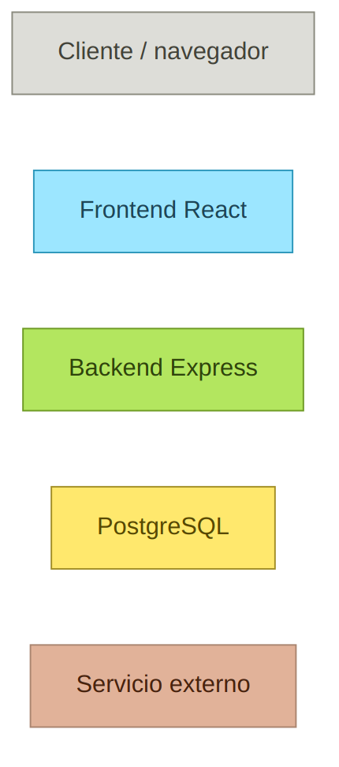
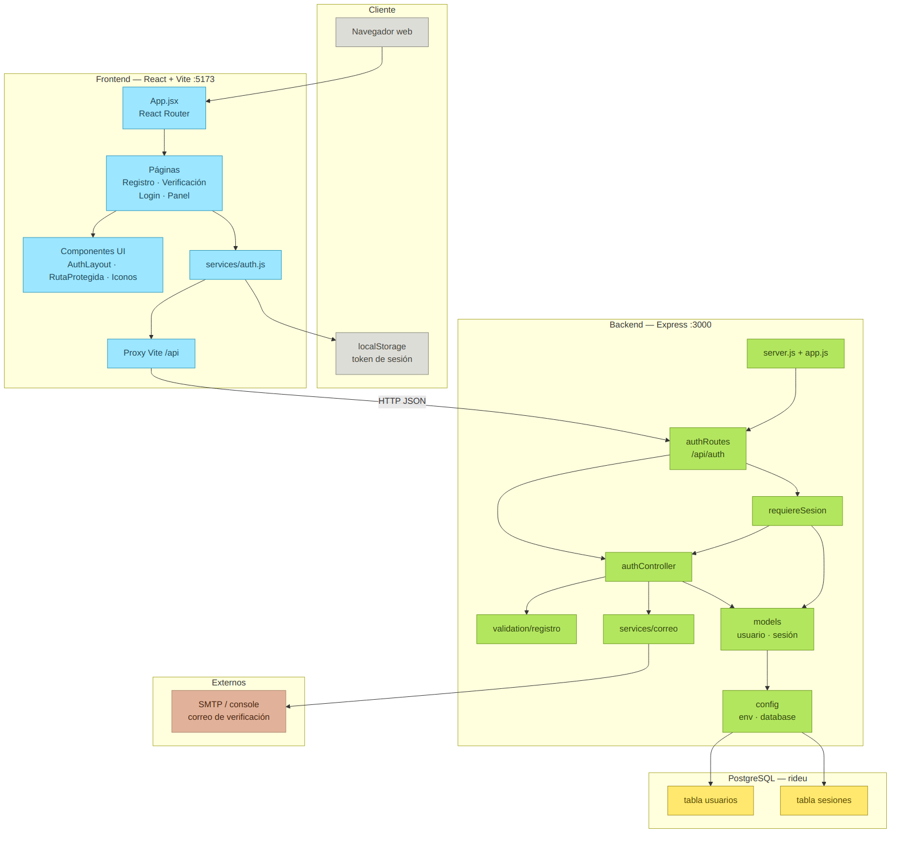
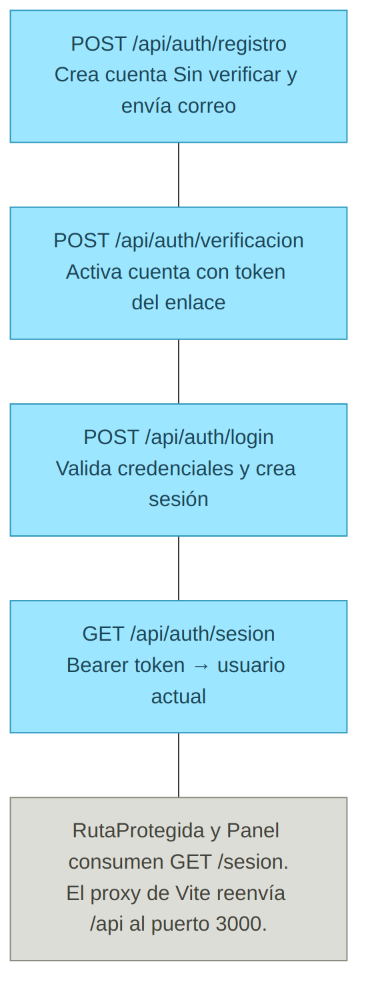
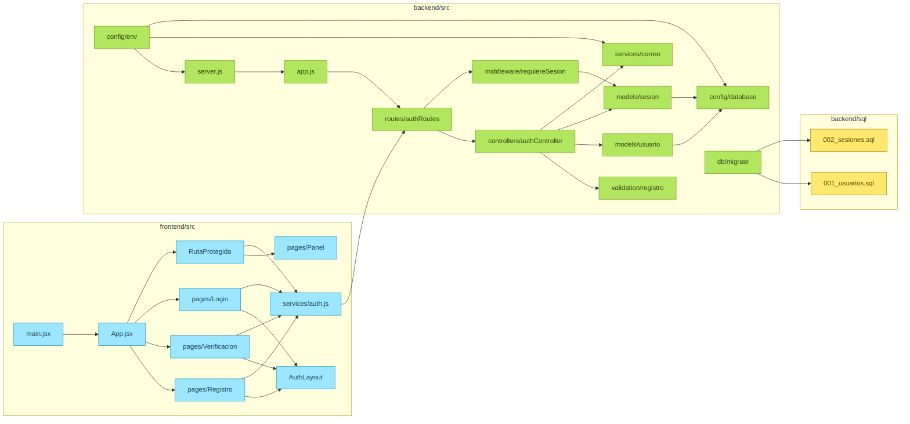

# Sprint 1 — Diagramas de componentes

Documentación de la arquitectura de **Ride U** (React + Vite, Express y PostgreSQL). Los diagramas muestran cómo se parten las responsabilidades entre cliente, frontend, backend, base de datos y servicios externos.

Los PNG están en [`diagramas/`](diagramas/).

---

## 0. Leyenda de capas

| Color | Capa | Rol |
| --- | --- | --- |
| Gris | Cliente / navegador | Donde corre la app y se guarda el token de sesión |
| Azul | Frontend React | UI, rutas y llamadas HTTP al API |
| Verde | Backend Express | Reglas de negocio, validación y acceso a datos |
| Amarillo | PostgreSQL | Persistencia de usuarios y sesiones |
| Marrón | Servicio externo | Envío de correo (SMTP) o impresión en consola |

---

## 1. Vista de componentes

**Qué muestra:** el sistema completo por capas y las dependencias entre componentes.

**Lectura del flujo**

1. El **navegador** carga la SPA de React (`App.jsx` + React Router).
2. Las **páginas** (Registro, Verificación, Login, Panel) usan el layout `AuthLayout`, los iconos y, cuando aplica, `RutaProtegida`.
3. `services/auth.js` habla con el API y guarda el token en **localStorage**.
4. El **proxy de Vite** reenvía `/api` al backend en el puerto 3000.
5. `authRoutes` reparte las peticiones a `authController` y, en rutas protegidas, al middleware `requiereSesion`.
6. El controlador usa **validación**, **models** (`usuario`, `sesión`) y el **servicio de correo**.
7. Los models llegan a PostgreSQL (`usuarios`, `sesiones`) a través de `config/database`.
8. El correo sale por **SMTP** o se imprime en consola según `MAIL_MODE`.

**Para qué sirve en el sprint:** deja claro el límite entre UI, API y datos, y dónde vive cada responsabilidad del registro, la verificación y el inicio de sesión.

---

## 2. Interfaces HTTP `/api/auth`

**Qué muestra:** el contrato público que el frontend consume. Todas las rutas cuelgan de `/api/auth`.

| Método y ruta | Qué hace |
| --- | --- |
| `POST /registro` | Crea la cuenta en estado «Sin verificar» y dispara el correo de verificación |
| `POST /verificacion` | Activa la cuenta con el token del enlace |
| `POST /login` | Comprueba correo/contraseña (solo si está verificada) y crea la sesión |
| `GET /sesion` | Devuelve el usuario actual si el Bearer token es válido |

**Notas**

- `RutaProtegida` y `Panel` llaman a `GET /sesion` para decidir si dejan pasar.
- En desarrollo, Vite reenvía `/api` a `http://localhost:3000`, así el frontend no necesita CORS propio.

**Para qué sirve en el sprint:** fija la interfaz entre capas sin entrar aún en el detalle de cada archivo.

---

## 3. Detalle interno por módulo

**Qué muestra:** los archivos reales del repositorio y cómo se encadenan.

### `frontend/src`

- `main.jsx` monta `App.jsx`.
- `App.jsx` define las rutas: Registro, Verificación, Login y Panel (este último detrás de `RutaProtegida`).
- Registro, Login y Verificación comparten `AuthLayout`.
- Esas páginas y `RutaProtegida` usan `services/auth.js` para hablar con el backend.

### `backend/src`

- `server.js` arranca Express; `app.js` monta `/api/auth`.
- `authRoutes` conecta con `authController` y con `requiereSesion` en `GET /sesion`.
- El controlador orquesta `validation/registro`, `models/usuario`, `models/sesion` y `services/correo`.
- `config/env` alimenta servidor, correo y base; `config/database` es el pool de PostgreSQL.
- `db/migrate` aplica los scripts SQL.

### `backend/sql`

- `001_usuarios.sql` — tabla de cuentas.
- `002_sesiones.sql` — tokens de sesión (solo se guarda el hash).

**Para qué sirve en el sprint:** sirve de mapa al código: si hay que tocar registro, login o sesión, se ve de un vistazo qué módulo toca cada capa.

---

## Origen

Los diagramas corresponden al tablero Miro **Ride U — Diagrama de componentes** y al estado del código en el sprint 1 (autenticación: registro, verificación, login y panel protegido).
